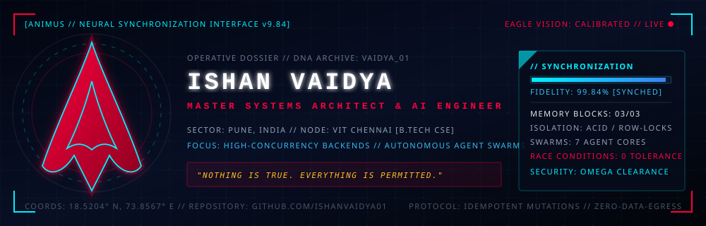

<div align="center">
  

  <br />

  <a href="https://github.com/ishanvaidya01">
    
  </a>
</div>

<br />

```
==================================================================================================
[!] ABSTERGO NEURAL INTERFACE // MEMORY DESYNCHRONIZATION SAFEGUARD: ARMED
OPERATIVE: Ishan Vaidya             | SECTOR: Pune, India [VIT Chennai Node]
RANK: Master Systems Architect       | SYNCHRONIZATION RATIO: 99.84% [MAX FIDELITY]
EAGLE VISION: ACTIVE                 | CREED: "Nothing is true. Everything is permitted."
==================================================================================================
```

### // THE CODEX: ARCHITECTURAL MANIFESTO

Where legacy distributed architectures crumble under high-velocity concurrency spikes, we enforce deterministic row-level locks and distributed coordination barriers. Where stochastic AI models hallucinate behind opaque interfaces, we construct explainable counterfactual reasoning matrices and deterministic multi-agent swarms with zero external data egress.

We work in the dark of backend infrastructure to deliver production light.

<div align="center">
  
</div>

### // MEMORY SEQUENCES: CLASSIFIED ARCHITECTURAL ARTIFACTS

#### SEQUENCE 01 // HIGH-CONCURRENCY INFRASTRUCTURE & DISTRIBUTED BLADES

### LivePass — High-Throughput Access Ingestion Engine [Master Assassin Spec]
Production-grade access governance platform engineered to eliminate double-redemption race conditions during burst ingress using PostgreSQL row-level locks (`SELECT FOR UPDATE`). Combines an offline-first client architecture leveraging IndexedDB transaction queues with cryptographic idempotency keys and bi-directional WebSocket broadcasting for synchronized, sub-100ms occupancy metrics.

### Sentio — Real-Time Telemetry & Teleoperation Black Box
Sub-second robotic telemetry streaming backplane built on Node.js Server-Sent Events (SSE) and cache-friendly in-memory ring buffers to prevent memory leaks under multi-kHz packet bursts. Features a client-side dynamic rule evaluation engine wired directly to native Web Audio API (`AudioContext`) synthesis for instantaneous, zero-latency acoustic alarm dispatch.

### ECRAS — Enterprise Compliance Recruitment Audit System
Dual-store enterprise compliance platform synchronizing a relational BCNF-normalized schema on Oracle XE with high-dimensional vector embeddings on ChromaDB. Utilizes PL/SQL autonomous transactions to enforce tamper-evident, auditable execution boundaries for EEOC bias tracking alongside locally hosted ONNX embedding pipelines to guarantee zero external data egress.

<br />

#### SEQUENCE 02 // AUTONOMOUS AGENT SWARMS & EAGLE VISION COGNITION

### AeroTrade XAI — Autonomous Supply Chain Orchestration Engine
Multi-modal supply chain dispatch agent built on LangChain with strictly typed Pydantic output validation and deterministic tool invocation guards. Replaces stochastic black-box outputs with an interactive "Why This, Not That" counterfactual reasoning matrix to surface actionable trade-offs across cost, latency, and vendor reliability.

### GST Archangel — The Seven-Agent Autonomous Tax Auditing Brotherhood
Multi-agent financial reconciliation platform coordinating 7 specialized micro-agents across OCR extraction, ledger reconciliation, and statutory risk scoring. Employs fine-tuned local Donut vision models for document parsing, deterministic RAG for Indian GST legal validation, and WebSocket multiplexing for real-time inspection of intermediate agentic thought streams.

### MindMesh — Collaborative Learning Engine with Event-Sourced State
Distributed interactive learning environment designed with an event-sourced architecture enabling deterministic state replay and non-destructive rewind of live multi-participant sessions. Orchestrates asynchronous state mutation through Django Channels and Redis Pub/Sub backplanes, augmented by a real-time Socratic AI copilot that generates contextual scaffolded hints without disclosing solution states.

### Scam Shield — Cross-Account Coordinated Fraud Detection Engine
Live conversational abuse detector combining semantic graph clustering and cross-account linguistic similarity to uncover syndicated fraud campaigns. Integrates SHAP-instrumented logistic regression for sub-millisecond, interpretable risk scoring while enforcing deliberate abstention heuristics on stealthy L3-Single anomalous signatures to minimize false positives.

<br />

#### SEQUENCE 03 // FIELD DEPLOYMENTS & APPLIED MACHINE LEARNING

### Shelf2Cash — Micro-Factoring & Kirana Liquidity Engine
B2B retail working-capital optimizer utilizing MongoDB Geospatial indexing for supply-cluster matchmaking and localized inventory pooling. Backed by a high-throughput FastAPI machine learning microservice that models historical kirana replenishment velocity to power predictive cash-flow forecasting and micro-factoring qualification.

### VarhadAgro — Agronomic Yield Forecast Model (Vidarbha Basin)
High-precision regional crop yield forecasting engine achieving an R² of 0.92 across the semi-arid Vidarbha agricultural zone. Ingests longitudinal rainfall distributions, micro-climate thermal variations, and dry-spell duration metrics to yield granular production estimates in kg/ha for localized risk mitigation.

### AgriGuard — Edge Plant Pathology Diagnostic System
Edge-optimized diagnostic API powered by FastAPI and a convolutional TensorFlow classifier trained on leaf pathology imagery. Delivers instant disease segmentation, projects localized contagion spread via dynamic Leaflet geospatial mapping, and provides automated dual-track mitigation protocols separating organic interventions from chemical treatments.

### Lassi House — High-Frequency Quick-Service POS & Order Pipeline
Campus-scale retail ordering system built with FastAPI, PostgreSQL, React, and Zustand state synchronization. Engineered with atomic order lifecycle transitions, automated stock ledger reconciliation, and strict webhooks idempotency handling integrated with Razorpay payment gateways.

<div align="center">
  
</div>

### // THE BROTHERHOOD ARSENAL: TACTICAL TECH STACK

| Weaponry / Discipline | Core Toolchain & Armaments |
| :--- | :--- |
| **Cryptographic Dialects** |      |
| **Animus Core & Concurrency** |         |
| **Eagle Vision & Cognitive Swarms** |       |
| **Holographic HUDs & Synch Layers** |      |

<div align="center">
  
</div>

### // EAGLE VISION: TELEMETRY & SYNCHRONIZATION RADAR

<div align="center">
  
  &nbsp;&nbsp;
  
</div>

<br />

<div align="center">
  

  <br />

  ```
  // SECURE TRANSMISSION CHANNELS //
  ```

  [SECURE DISPATCH (EMAIL)](mailto:ishan.vaidya01@gmail.com) &nbsp;|&nbsp; [BROTHERHOOD REGISTRY (LINKEDIN)](https://www.linkedin.com/in/ishanvaidya-cse) &nbsp;|&nbsp; [NEURAL REPOSITORY (GITHUB)](https://github.com/ishanvaidya01)

  <br />

  <sub><em>Requiescat in pace, latency. Nothing is true; everything is permitted.</em></sub>
</div>