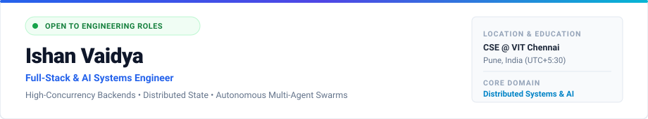

<picture>
  <source media="(prefers-color-scheme: dark)" srcset="assets/banner-dark.svg">
  <source media="(prefers-color-scheme: light)" srcset="assets/banner-light.svg">
  
</picture>

   
  
  &nbsp;
  
  &nbsp;
  
  &nbsp;
  

---

### Executive Profile

I am a Computer Science undergraduate at **VIT Chennai** specializing in **high-concurrency backend infrastructure**, **distributed state consistency**, and **autonomous multi-agent AI architectures**. My engineering ethos centers on designing resilient systems with zero tolerance for race conditions, data loss, or opaque black-box abstractions.

- **Systems & Concurrency:** Architecting high-throughput data ingestion pipelines using PostgreSQL transactional locking (`SELECT FOR UPDATE`), sub-second streaming backplanes via WebSockets / SSE, and in-memory ring buffers.
- **Agentic AI & ML:** Engineering deterministic multi-agent swarms using LangChain and local models (ONNX, Donut) paired with counterfactual explainability (SHAP, XAI) and strictly typed Pydantic validation.
- **Enterprise Dual-Store Systems:** Building hybrid architectures that synchronize BCNF-normalized relational structures (Oracle XE, PostgreSQL) with high-dimensional vector embeddings (ChromaDB).

---

### Flagship Systems & Architectures

<table>
  <tr>
    <td width="50%" valign="top">
      <h3>LivePass &nbsp;<code>FLAGSHIP</code></h3>
      
<strong>High-Throughput Access Governance &amp; Ingestion Engine</strong>

      
Production-grade event check-in platform engineered to withstand peak burst ingress while eliminating ticket duplication and race conditions.

      <ul>
        <li><strong>Concurrency Safety:</strong> PostgreSQL row-level locks (<code>SELECT FOR UPDATE</code>) ensure strict serializability under concurrent redemptions.</li>
        <li><strong>Offline-First Pipeline:</strong> IndexedDB client queue with cryptographic idempotency keys ensures flawless syncing across network dropouts.</li>
        <li><strong>Real-Time Synchronization:</strong> Bi-directional WebSocket broadcasting keeps venue occupancy metrics in sub-100ms sync.</li>
      </ul>
      
<strong>Stack:</strong> PostgreSQL &bull; FastAPI &bull; WebSockets &bull; IndexedDB &bull; React &bull; Tailwind CSS

    </td>
    <td width="50%" valign="top">
      <h3>Sentio</h3>
      
<strong>Real-Time Robotic Telemetry &amp; Diagnostics Black Box</strong>

      
High-frequency robotic diagnostics backplane engineered to process multi-kHz telemetry bursts without memory fragmentation or event-loop starvation.

      <ul>
        <li><strong>Sub-Second Streaming:</strong> Server-Sent Events (SSE) backplane coupled with cache-friendly circular in-memory ring buffers.</li>
        <li><strong>Acoustic Alarm Engine:</strong> Dynamic client-side rule evaluation triggers native Web Audio API (<code>AudioContext</code>) for zero-latency auditory alerts.</li>
        <li><strong>Zero Data Loss:</strong> Constant-time $O(1)$ buffer ingestion prevents memory leaks during erratic network degradation.</li>
      </ul>
      
<strong>Stack:</strong> Node.js &bull; Server-Sent Events &bull; In-Memory Ring Buffers &bull; Web Audio API &bull; TypeScript

    </td>
  </tr>
  <tr>
    <td width="50%" valign="top">
      <h3>GST Archangel</h3>
      
<strong>Seven-Agent Autonomous Tax Auditing Swarm</strong>

      
Multi-agent financial intelligence system orchestrating 7 specialized autonomous micro-agents across OCR extraction, ledger reconciliation, and statutory risk auditing.

      <ul>
        <li><strong>Local Vision OCR:</strong> Fine-tuned local Donut vision models for structured document parsing without third-party API exposure.</li>
        <li><strong>Statutory RAG:</strong> Deterministic Retrieval-Augmented Generation validating transactions against Indian GST law.</li>
        <li><strong>Live Telemetry:</strong> WebSocket multiplexing streams intermediate agentic reasoning chains for transparent human verification.</li>
      </ul>
      
<strong>Stack:</strong> LangChain &bull; Donut OCR &bull; FastAPI &bull; ChromaDB &bull; RAG &bull; WebSockets

    </td>
    <td width="50%" valign="top">
      <h3>ECRAS</h3>
      
<strong>Enterprise Compliance Recruitment Audit System</strong>

      
Dual-store enterprise auditing platform enforcing strict EEOC bias verification across hiring pipelines while guaranteeing zero external data egress.

      <ul>
        <li><strong>Dual-Store Core:</strong> Synchronizes BCNF-normalized relational state in Oracle XE with high-dimensional vector embeddings in ChromaDB.</li>
        <li><strong>Tamper-Evident Auditing:</strong> Autonomous PL/SQL transactions create auditable, isolated execution boundaries.</li>
        <li><strong>Local Embeddings:</strong> High-speed ONNX runtime embeddings deployed on local edge nodes for total data privacy.</li>
      </ul>
      
<strong>Stack:</strong> Oracle XE &bull; ChromaDB &bull; PL/SQL &bull; ONNX Runtime &bull; Python

    </td>
  </tr>
</table>

---

### Selected Engineering Portfolio

#### Autonomous Multi-Agent Systems & Explainable AI
- **AeroTrade XAI — Autonomous Supply Chain Orchestration Engine**  
  Multi-modal supply chain dispatch agent built on LangChain with strictly typed Pydantic output validation and deterministic tool invocation guards. Replaces stochastic black-box outputs with an interactive "Why This, Not That" counterfactual reasoning matrix to surface actionable trade-offs across cost, latency, and vendor reliability.
- **MindMesh — Collaborative Learning Engine with Event-Sourced State**  
  Distributed interactive learning environment designed with an event-sourced architecture enabling deterministic state replay and non-destructive rewind of live multi-participant sessions. Orchestrates asynchronous state mutation through Django Channels and Redis Pub/Sub backplanes, augmented by a real-time Socratic AI copilot that generates contextual scaffolded hints without disclosing solution states.
- **Scam Shield — Cross-Account Coordinated Fraud Detection Engine**  
  Live conversational abuse detector combining semantic graph clustering and cross-account linguistic similarity to uncover syndicated fraud campaigns. Integrates SHAP-instrumented logistic regression for sub-millisecond, interpretable risk scoring while enforcing deliberate abstention heuristics on stealthy L3-Single anomalous signatures to minimize false positives.

#### Applied Machine Learning & High-Impact Products
- **Shelf2Cash — Micro-Factoring & Kirana Liquidity Engine**  
  B2B retail working-capital optimizer utilizing MongoDB Geospatial indexing for supply-cluster matchmaking and localized inventory pooling. Backed by a high-throughput FastAPI machine learning microservice that models historical kirana replenishment velocity to power predictive cash-flow forecasting and micro-factoring qualification.
- **VarhadAgro — Agronomic Yield Forecast Model (Vidarbha Basin)**  
  High-precision regional crop yield forecasting engine achieving an $R^2$ of 0.92 across the semi-arid Vidarbha agricultural zone. Ingests longitudinal rainfall distributions, micro-climate thermal variations, and dry-spell duration metrics to yield granular production estimates in kg/ha for localized risk mitigation.
- **AgriGuard — Edge Plant Pathology Diagnostic System**  
  Edge-optimized diagnostic API powered by FastAPI and a convolutional TensorFlow classifier trained on leaf pathology imagery. Delivers instant disease segmentation, projects localized contagion spread via dynamic Leaflet geospatial mapping, and provides automated dual-track mitigation protocols separating organic interventions from chemical treatments.
- **Lassi House — High-Frequency Quick-Service POS & Order Pipeline**  
  Campus-scale retail ordering system built with FastAPI, PostgreSQL, React, and Zustand state synchronization. Engineered with atomic order lifecycle transitions, automated stock ledger reconciliation, and strict webhooks idempotency handling integrated with Razorpay payment gateways.

---

### Technical Matrix & Toolchain

<table>
  <tr>
    <td width="22%"><strong>Core Languages</strong></td>
    <td>
      
      
      
      
      
    </td>
  </tr>
  <tr>
    <td><strong>Backend &amp; Systems</strong></td>
    <td>
      
      
      
      
      
      
      
      
    </td>
  </tr>
  <tr>
    <td><strong>AI &amp; Data Engineering</strong></td>
    <td>
      
      
      
      
      
      
    </td>
  </tr>
  <tr>
    <td><strong>Frontend &amp; UI</strong></td>
    <td>
      
      
      
      
      
    </td>
  </tr>
</table>

---

### Activity & Repository Metrics

  <picture>
    <source media="(prefers-color-scheme: dark)" srcset="https://github-readme-stats.vercel.app/api?username=ishanvaidya01&show_icons=true&hide_border=true&title_color=38bdf8&text_color=cbd5e1&icon_color=38bdf8&bg_color=0d1117&hide=rank" />
    <source media="(prefers-color-scheme: light)" srcset="https://github-readme-stats.vercel.app/api?username=ishanvaidya01&show_icons=true&hide_border=true&title_color=0284c7&text_color=334155&icon_color=0284c7&bg_color=ffffff&hide=rank" />
    
  </picture>
  &nbsp;&nbsp;
  <picture>
    <source media="(prefers-color-scheme: dark)" srcset="https://github-readme-stats.vercel.app/api/top-langs/?username=ishanvaidya01&layout=compact&hide_border=true&title_color=38bdf8&text_color=cbd5e1&bg_color=0d1117" />
    <source media="(prefers-color-scheme: light)" srcset="https://github-readme-stats.vercel.app/api/top-langs/?username=ishanvaidya01&layout=compact&hide_border=true&title_color=0284c7&text_color=334155&bg_color=ffffff" />
    
  </picture>

---

  <strong>Let's Build Resilient Systems Together</strong>
    
  <a href="mailto:ishan.vaidya01@gmail.com">ishan.vaidya01@gmail.com</a> &nbsp;&bull;&nbsp; 
  <a href="https://linkedin.com/in/ishanvaidya-cse">linkedin.com/in/ishanvaidya-cse</a> &nbsp;&bull;&nbsp; 
  <a href="https://github.com/ishanvaidya01">github.com/ishanvaidya01</a>

