<table width="100%" border="0" cellspacing="0" cellpadding="0">
  <tr>
    <td width="72%" valign="middle" align="left">
      <picture>
        <source media="(prefers-color-scheme: dark)" srcset="assets/hero-terminal-dark.svg">
        <source media="(prefers-color-scheme: light)" srcset="assets/hero-terminal-light.svg">
        
      </picture>
    </td>
    <td width="28%" valign="middle" align="center">
      <picture>
        <source media="(prefers-color-scheme: dark)" srcset="assets/avatar-ring-dark.svg">
        <source media="(prefers-color-scheme: light)" srcset="assets/avatar-ring-light.svg">
        
      </picture>
    </td>
  </tr>
</table>

  <strong>CSE Undergraduate @ VIT Chennai &nbsp;|&nbsp; Full-Stack &amp; AI Systems Engineer &nbsp;&bull;&nbsp; Pune, India</strong>

 

<picture>
  <source media="(prefers-color-scheme: dark)" srcset="assets/section-divider-dark.svg">
  <source media="(prefers-color-scheme: light)" srcset="assets/section-divider-light.svg">
  
</picture>

 

<!-- TELEMETRY & STATS -->
<picture>
  <source media="(prefers-color-scheme: dark)" srcset="assets/header-telemetry-dark.svg">
  <source media="(prefers-color-scheme: light)" srcset="assets/header-telemetry-light.svg">
  
</picture>

<picture>
  <source media="(prefers-color-scheme: dark)" srcset="assets/stats-card-dark.svg">
  <source media="(prefers-color-scheme: light)" srcset="assets/stats-card-light.svg">
  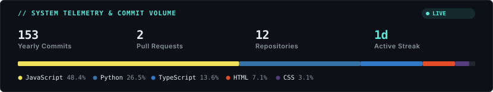
</picture>

  

<picture>
  <source media="(prefers-color-scheme: dark)" srcset="https://raw.githubusercontent.com/ishanvaidya01/ishanvaidya01/output/github-contribution-grid-snake-dark.svg">
  <source media="(prefers-color-scheme: light)" srcset="https://raw.githubusercontent.com/ishanvaidya01/ishanvaidya01/output/github-contribution-grid-snake.svg">
  
</picture>

 

<picture>
  <source media="(prefers-color-scheme: dark)" srcset="assets/section-divider-dark.svg">
  <source media="(prefers-color-scheme: light)" srcset="assets/section-divider-light.svg">
  
</picture>

 

<!-- CATEGORY 01: HIGH-CONCURRENCY -->
<picture>
  <source media="(prefers-color-scheme: dark)" srcset="assets/header-01-dark.svg">
  <source media="(prefers-color-scheme: light)" srcset="assets/header-01-light.svg">
  
</picture>

<!-- Flagship: LivePass -->
<a href="https://github.com/ishanvaidya01">
  <picture>
    <source media="(prefers-color-scheme: dark)" srcset="assets/card-livepass-dark.svg">
    <source media="(prefers-color-scheme: light)" srcset="assets/card-livepass-light.svg">
    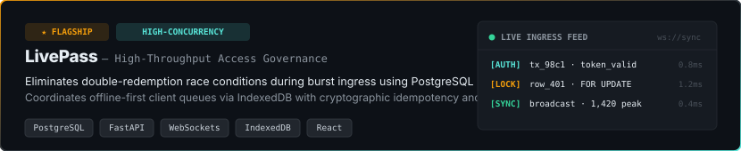
  </picture>
</a>

  <strong><a href="https://github.com/ishanvaidya01">LivePass</a></strong> &#8212; <em>Production-Grade Access Governance &amp; Event Ingestion Engine.</em> Eliminates double-redemption race conditions during burst ingress using PostgreSQL row-level locks (<code>SELECT FOR UPDATE</code>). Coordinates an offline-first client architecture leveraging IndexedDB transaction queues with cryptographic idempotency keys and sub-100ms bi-directional WebSocket occupancy broadcasts.

<table width="100%" border="0" cellspacing="8" cellpadding="0">
  <tr>
    <td width="50%" valign="top">
      <a href="https://github.com/ishanvaidya01">
        <picture>
          <source media="(prefers-color-scheme: dark)" srcset="assets/card-sentio-dark.svg">
          <source media="(prefers-color-scheme: light)" srcset="assets/card-sentio-light.svg">
          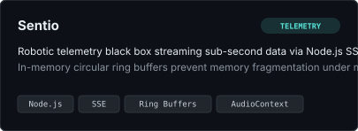
        </picture>
      </a>
      

        <strong><a href="https://github.com/ishanvaidya01">Sentio</a></strong> &#8212; <em>Real-Time Robotic Telemetry &amp; Teleoperation Black Box.</em> Streams sub-second telemetry using Node.js Server-Sent Events (SSE) and cache-friendly in-memory circular ring buffers that prevent memory fragmentation during multi-kHz packet bursts, triggering native <code>AudioContext</code> alarms.
      

    </td>
    <td width="50%" valign="top">
      <a href="https://github.com/ishanvaidya01">
        <picture>
          <source media="(prefers-color-scheme: dark)" srcset="assets/card-ecras-dark.svg">
          <source media="(prefers-color-scheme: light)" srcset="assets/card-ecras-light.svg">
          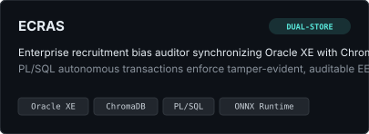
        </picture>
      </a>
      

        <strong><a href="https://github.com/ishanvaidya01">ECRAS</a></strong> &#8212; <em>Enterprise Recruitment Compliance &amp; Bias Audit System.</em> Dual-store architecture synchronizing BCNF-normalized relational schemas on Oracle XE with vector embeddings on ChromaDB, using PL/SQL autonomous transactions and local ONNX embeddings for zero data egress EEOC auditing.
      

    </td>
  </tr>
</table>

 

<picture>
  <source media="(prefers-color-scheme: dark)" srcset="assets/section-divider-dark.svg">
  <source media="(prefers-color-scheme: light)" srcset="assets/section-divider-light.svg">
  
</picture>

 

<!-- CATEGORY 02: AUTONOMOUS AI & MULTI-AGENT SYSTEMS -->
<picture>
  <source media="(prefers-color-scheme: dark)" srcset="assets/header-02-dark.svg">
  <source media="(prefers-color-scheme: light)" srcset="assets/header-02-light.svg">
  
</picture>

<table width="100%" border="0" cellspacing="8" cellpadding="0">
  <tr>
    <td width="50%" valign="top">
      <a href="https://github.com/ishanvaidya01">
        <picture>
          <source media="(prefers-color-scheme: dark)" srcset="assets/card-aerotrade-dark.svg">
          <source media="(prefers-color-scheme: light)" srcset="assets/card-aerotrade-light.svg">
          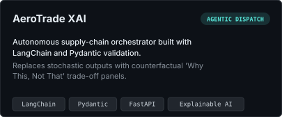
        </picture>
      </a>
      

        <strong><a href="https://github.com/ishanvaidya01">AeroTrade XAI</a></strong> &#8212; <em>Autonomous Supply-Chain Orchestrator.</em> LangChain agent with deterministic tool execution guards and Pydantic validation, surfacing trade-offs via transparent &quot;Why This, Not That&quot; counterfactual reasoning panels.
      

    </td>
    <td width="50%" valign="top">
      <a href="https://github.com/ishanvaidya01">
        <picture>
          <source media="(prefers-color-scheme: dark)" srcset="assets/card-gst-archangel-dark.svg">
          <source media="(prefers-color-scheme: light)" srcset="assets/card-gst-archangel-light.svg">
          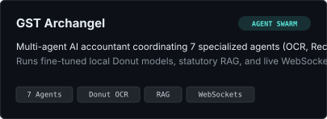
        </picture>
      </a>
      

        <strong><a href="https://github.com/ishanvaidya01">GST Archangel</a></strong> &#8212; <em>Autonomous Multi-Agent Tax Auditing Swarm.</em> Coordinates 7 specialized agents across OCR, reconciliation, and risk scoring using local Donut models, statutory RAG legal validation, and real-time WebSocket thought streaming.
      

    </td>
  </tr>
  <tr>
    <td width="50%" valign="top">
      <a href="https://github.com/ishanvaidya01">
        <picture>
          <source media="(prefers-color-scheme: dark)" srcset="assets/card-mindmesh-dark.svg">
          <source media="(prefers-color-scheme: light)" srcset="assets/card-mindmesh-light.svg">
          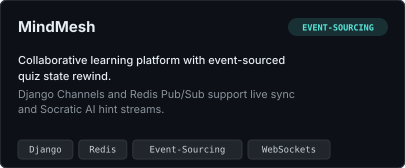
        </picture>
      </a>
      

        <strong><a href="https://github.com/ishanvaidya01">MindMesh</a></strong> &#8212; <em>Event-Sourced Collaborative Learning Platform.</em> Implements deterministic state replay and quiz rewind via Django Channels and Redis Pub/Sub, delivering live multi-user synchronization with Socratic hint generation.
      

    </td>
    <td width="50%" valign="top">
      <a href="https://github.com/ishanvaidya01">
        <picture>
          <source media="(prefers-color-scheme: dark)" srcset="assets/card-scamshield-dark.svg">
          <source media="(prefers-color-scheme: light)" srcset="assets/card-scamshield-light.svg">
          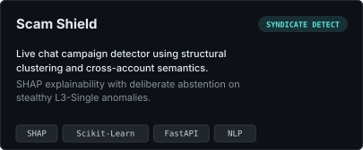
        </picture>
      </a>
      

        <strong><a href="https://github.com/ishanvaidya01">Scam Shield</a></strong> &#8212; <em>Live Chat Campaign &amp; Coordinated Fraud Detector.</em> Structural graph clustering and cross-account semantic analysis with SHAP explainability and deliberate abstention heuristics on stealthy L3-Single anomalies.
      

    </td>
  </tr>
</table>

 

<picture>
  <source media="(prefers-color-scheme: dark)" srcset="assets/section-divider-dark.svg">
  <source media="(prefers-color-scheme: light)" srcset="assets/section-divider-light.svg">
  
</picture>

 

<!-- CATEGORY 03: REAL-WORLD IMPACT & ML APPLICATIONS -->
<picture>
  <source media="(prefers-color-scheme: dark)" srcset="assets/header-03-dark.svg">
  <source media="(prefers-color-scheme: light)" srcset="assets/header-03-light.svg">
  
</picture>

<table width="100%" border="0" cellspacing="8" cellpadding="0">
  <tr>
    <td width="50%" valign="top">
      <a href="https://github.com/ishanvaidya01">
        <picture>
          <source media="(prefers-color-scheme: dark)" srcset="assets/card-shelf2cash-dark.svg">
          <source media="(prefers-color-scheme: light)" srcset="assets/card-shelf2cash-light.svg">
          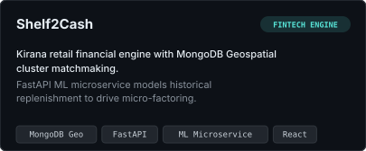
        </picture>
      </a>
      

        <strong><a href="https://github.com/ishanvaidya01">Shelf2Cash</a></strong> &#8212; <em>Kirana Retail Liquidity &amp; Micro-Factoring Engine.</em> Uses MongoDB 2dsphere geospatial clustering for supply matchmaking and a FastAPI ML microservice forecasting cash flow from historical velocity.
      

    </td>
    <td width="50%" valign="top">
      <a href="https://github.com/ishanvaidya01">
        <picture>
          <source media="(prefers-color-scheme: dark)" srcset="assets/card-varhadagro-dark.svg">
          <source media="(prefers-color-scheme: light)" srcset="assets/card-varhadagro-light.svg">
          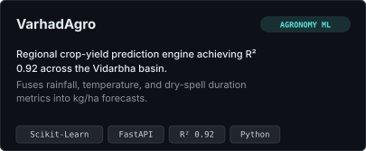
        </picture>
      </a>
      

        <strong><a href="https://github.com/ishanvaidya01">VarhadAgro</a></strong> &#8212; <em>Agronomic Yield Forecast Model (Vidarbha Basin).</em> Multivariate ML model achieving R&#178; 0.92 on longitudinal rainfall, thermal variance, and dry spells to predict granular agricultural yield in kg/ha.
      

    </td>
  </tr>
  <tr>
    <td width="50%" valign="top">
      <a href="https://github.com/ishanvaidya01">
        <picture>
          <source media="(prefers-color-scheme: dark)" srcset="assets/card-agriguard-dark.svg">
          <source media="(prefers-color-scheme: light)" srcset="assets/card-agriguard-light.svg">
          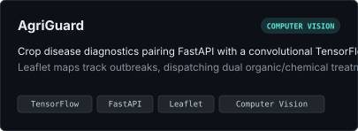
        </picture>
      </a>
      

        <strong><a href="https://github.com/ishanvaidya01">AgriGuard</a></strong> &#8212; <em>Edge Plant Pathology Diagnostic System.</em> FastAPI microservice paired with a convolutional TensorFlow model for leaf pathology segmentation, Leaflet outbreak maps, and dual-track organic/inorganic remedies.
      

    </td>
    <td width="50%" valign="top">
      <a href="https://github.com/ishanvaidya01">
        <picture>
          <source media="(prefers-color-scheme: dark)" srcset="assets/card-lassihouse-dark.svg">
          <source media="(prefers-color-scheme: light)" srcset="assets/card-lassihouse-light.svg">
          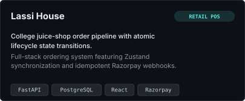
        </picture>
      </a>
      

        <strong><a href="https://github.com/ishanvaidya01">Lassi House</a></strong> &#8212; <em>High-Frequency Quick-Service POS &amp; Order Pipeline.</em> Campus retail ordering engine built on FastAPI, PostgreSQL, React, and Zustand with atomic inventory state transitions and idempotent Razorpay webhooks.
      

    </td>
  </tr>
</table>

 

<picture>
  <source media="(prefers-color-scheme: dark)" srcset="assets/section-divider-dark.svg">
  <source media="(prefers-color-scheme: light)" srcset="assets/section-divider-light.svg">
  
</picture>

 

<!-- TECH STACK -->
<picture>
  <source media="(prefers-color-scheme: dark)" srcset="assets/header-stack-dark.svg">
  <source media="(prefers-color-scheme: light)" srcset="assets/header-stack-light.svg">
  
</picture>

<picture>
  <source media="(prefers-color-scheme: dark)" srcset="assets/tech-stack-dark.svg">
  <source media="(prefers-color-scheme: light)" srcset="assets/tech-stack-light.svg">
  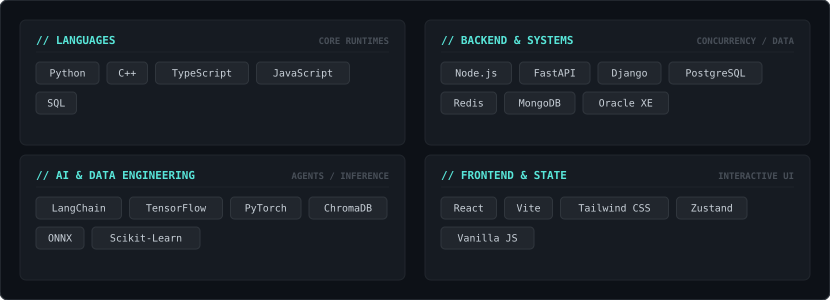
</picture>

  

<picture>
  <source media="(prefers-color-scheme: dark)" srcset="assets/section-divider-dark.svg">
  <source media="(prefers-color-scheme: light)" srcset="assets/section-divider-light.svg">
  
</picture>

 

<!-- FOOTER -->

  <a href="mailto:ishan.vaidya01@gmail.com"><strong>Email</strong></a> &nbsp;&bull;&nbsp; 
  <a href="https://linkedin.com/in/ishanvaidya-cse"><strong>LinkedIn</strong></a> &nbsp;&bull;&nbsp; 
  <a href="https://github.com/ishanvaidya01"><strong>Portfolio</strong></a>
    
  Architected with precision &bull; Theme-Adaptive &bull; Self-Hosted Vector Assets

